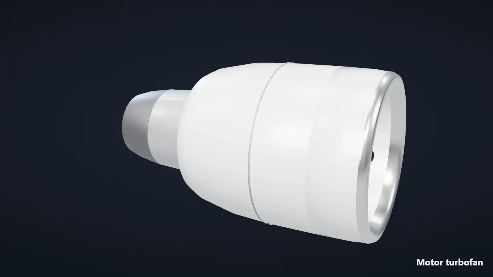

# Pronóstico de la vida útil remanente de motores turbofán (NASA C-MAPSS)

Proyecto final de **Introducción a Ciencia de Datos** (Posgrado en Ciencias de la Computación, CICESE).
Autor: Carlos Campos Sarabia.

<p align="center">
  
</p>
<p align="center"><sub>Las partes de un motor turbofán como los que simula C-MAPSS; sus modos de falla degradan el compresor de alta (HPC) y el ventilador (fan). Modelo 3D hecho con código en three.js; los detalles internos son ilustrativos.</sub></p>

## Descripción

Se predice cuántos ciclos de vuelo le quedan a un motor turbofán antes de fallar (**RUL**, *Remaining Useful Life*) a partir de las lecturas de sus 21 sensores. Es un problema de **regresión** sobre series de tiempo: cada fila es un ciclo de operación de un motor.

<p align="center">
  
</p>
<p align="center"><sub>Degradación del motor 1 de FD001 a lo largo de sus 192 ciclos. Las lecturas de T50, Ps30, phi y BPR son las reales del dataset (puntos grises: cada ciclo; línea: media móvil de 20 ciclos). El desgaste que se ve en el modelo 3D es ilustrativo y sigue a esas lecturas.</sub></p>

El flujo del proyecto es:
1. **Datos:** carga de los 4 subconjuntos, cálculo del RUL y etiqueta de la condición de vuelo de cada ciclo.
2. **Análisis exploratorio:** calidad de los datos, vida de los motores, zona sana y de desgaste, y sensores útiles.
3. **Preprocesamiento:** normalización de cada sensor dentro de su condición de vuelo (solo con estadísticas de train) y ventanas deslizantes de 10 y 70 ciclos.
4. **Modelado:** validación por motor (`GroupKFold`), línea base, comparación de 6 modelos (Ridge, kNN, SVR, Random Forest, XGBoost y LightGBM), ajuste de LightGBM con Optuna y prueba con el modelo preentrenado Chronos-2.
5. **Evaluación:** una sola evaluación en el test oficial (RMSE contra el RUL real y score NASA), análisis de errores por zona de RUL e importancia de los sensores.
6. **Preguntas de investigación y conclusiones.**

### Preguntas de investigación
- **P1:** ¿un modelo con ventanas deslizantes supera a los notebooks reportados en Kaggle?
- **P2:** ¿qué sensores anticipan mejor la degradación del motor?
- **P3:** ¿tomar en cuenta las condiciones de operación mejora la predicción de la vida útil?

### Resultado principal
LightGBM con ventanas de 10 + 70 ciclos, normalización por condición e hiperparámetros de Optuna:

| | FD001 | FD002 | FD003 | FD004 | Promedio |
|:--|--:|--:|--:|--:|--:|
| RMSE de test (RUL real, ciclos) | 13.10 | 21.55 | 11.91 | 23.12 | 17.42 |
| Con Chronos-2 | 12.66 | 21.51 | 11.90 | 22.79 | 17.22 |

Las respuestas a las preguntas están en las secciones 10 y 11 del notebook.

## Origen de los datos

**C-MAPSS** (*Commercial Modular Aero-Propulsion System Simulation*), NASA Ames Research Center: Saxena, A., & Goebel, K. (2008). *Turbofan Engine Degradation Simulation Data Set*. NASA Prognostics Data Repository.

- Son datos **simulados** de una flota de motores. En train cada motor opera hasta fallar; en test la serie termina antes de la falla y `RUL_FD00X.txt` da el RUL real de su último ciclo.
- Es una obra del gobierno de EE. UU. de uso libre citando la fuente, así que **los archivos originales sí se incluyen** en `CMAPSSData/` (≈ 43 MB en total).
- Si faltaran, se descargan del NASA Prognostics Data Repository (búsqueda: "CMAPSS Jet Engine Simulated Data") y se descomprimen en `CMAPSSData/`, con los nombres `train_FD00X.txt`, `test_FD00X.txt` y `RUL_FD00X.txt`.

| Subconjunto | Condiciones de operación | Modos de falla | Motores train | Motores test |
|:--|:--:|:--|:--:|:--:|
| FD001 | 1 | HPC | 100 | 100 |
| FD002 | 6 | HPC | 260 | 259 |
| FD003 | 1 | HPC y ventilador | 100 | 100 |
| FD004 | 6 | HPC y ventilador | 249 | 248 |

## Requisitos

- **Python 3.14** (probado con 3.14.10 en Windows 11).
- Librerías con las versiones de `requirements.txt`:
  ```bash
  pip install -r requirements.txt
  ```
- **PyTorch** se usa solo en la sección 9.11 (Chronos-2). Con una GPU NVIDIA se instala la versión con CUDA (el notebook se ejecutó con `torch 2.15.0+cu132`); sin GPU funciona con la versión de CPU, pero calcular los embeddings tarda más. Las instrucciones están en `requirements.txt`.
- La primera vez, Chronos-2 descarga el modelo `autogluon/chronos-2-small` de Hugging Face (requiere internet).

## Cómo ejecutar

1. Abrir `Proyecto-CMAPSS-v2.ipynb` con la carpeta `Proyecto/` como directorio de trabajo (todas las rutas son relativas a ella).
2. **Reiniciar el kernel y ejecutar todas las celdas.** La ejecución completa tarda ≈ 2.5 horas en una laptop con 16 núcleos; lo más lento es la comparación de ventanas (sección 7, ≈ 40 min) y Optuna (sección 9.3, ≈ 1 h).
3. Las semillas están fijas (`random_state=42` en los modelos, semillas 0–2 en los pliegues, `seed=42` en Optuna y en PyTorch), así que los resultados se repiten.

## Estructura de archivos

```
Proyecto/
├── Proyecto-CMAPSS-v2.ipynb      # notebook del proyecto
├── README.md
├── requirements.txt              # versiones de las librerías
├── CMAPSSData/
│   ├── train_FD00X.txt           # datos originales de NASA (4 subconjuntos)
│   ├── test_FD00X.txt
│   ├── RUL_FD00X.txt
│   ├── readme.txt                # descripción original del dataset
│   ├── *.pdf                     # artículos de referencia sobre C-MAPSS
│   └── CMAPSS-v2/                # archivos que genera el notebook (no se suben al repositorio)
│       ├── train_todos.csv, test_todos.csv
│       ├── comparacion_ventanas.csv, comparacion_modelos.csv, optuna_lightgbm.csv
│       └── chronos/              # caché de los embeddings de Chronos-2 (≈ 125 MB)
├── Predicciones/
│   └── predicciones_test_v2.csv  # RUL predicho y real de cada motor de test
└── Images/                       # las 17 figuras que genera el notebook (Figura 01 … Figura 17)
    ├── turbofan.webp             # animación del motor que se muestra en este README
    └── degradacion.webp          # animación de la degradación del motor FD001_1
```

La carpeta `CMAPSSData/CMAPSS-v2/` no se sube porque pesa más de 50 MB y el notebook la vuelve a generar al ejecutarse.

## Declaración de uso de IA generativa

Se usó Claude (Anthropic) mediante Claude Code como asistente de redaccion en documentación. El detalle está en la última celda del notebook.
