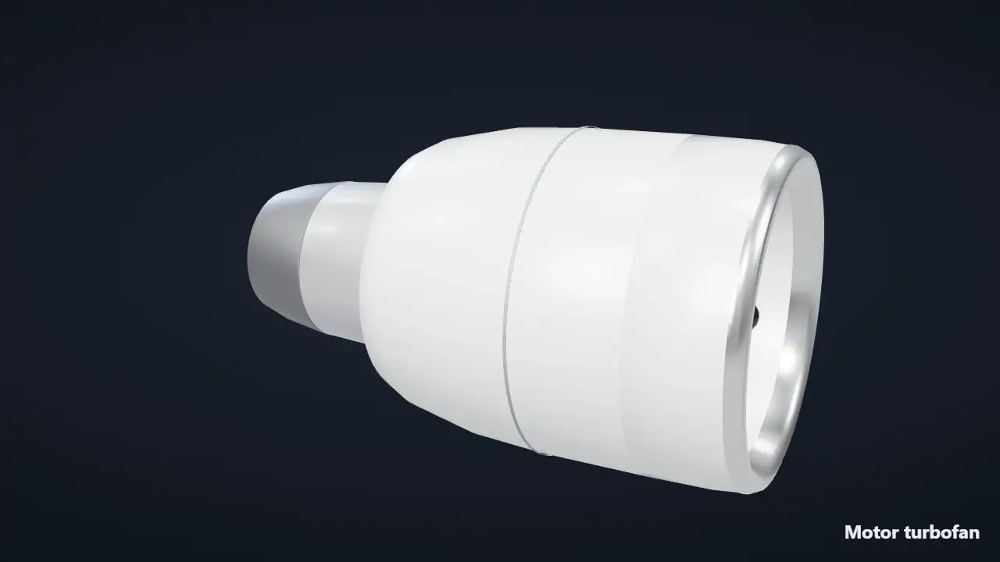

# Introduccion a ciencia de datos

  

Proyecto final: <a href="./Proyecto/">pronóstico de la vida útil remanente de motores turbofán (NASA C-MAPSS)</a>. Modelo 3D hecho con código en three.js; los detalles internos son ilustrativos.

Este repositorio contiene el material desarrollado durante el curso de Introducción a Ciencia de Datos, como parte de mi formación en la maestría en Ciencias de la Computación. Aquí se recopilan los notebooks, ejercicios, tareas y proyectos realizados a lo largo del semestre, documentando el proceso de aprendizaje de los fundamentos y herramientas esenciales de la disciplina.

El curso abarca los conceptos centrales del flujo de trabajo en ciencia de datos: desde la recolección y limpieza de datos, pasando por el análisis exploratorio (EDA) y la visualización, hasta la aplicación de técnicas estadísticas y modelos introductorios de machine learning. El objetivo es desarrollar una base sólida tanto en los principios teóricos como en la implementación práctica utilizando herramientas del ecosistema de Python (pandas, NumPy, Matplotlib/Seaborn, scikit-learn, entre otras).

Cada carpeta o notebook dentro de este repositorio corresponde a un tema o unidad específica del curso, e incluye tanto el código como las explicaciones y conclusiones relevantes de cada ejercicio.

| Carpeta | Contenido |
| --- | --- |
| [Tareas](./Tareas/) | Trabajos realizados en clase |
| [Practicas](./Practicas/) | Prácticas asignadas en clase |
| [Datos](./Datos/) | Datos utilizados para cada práctica realizada |
| [Proyecto](./Proyecto/) | Proyecto final: pronóstico de vida útil remanente con NASA C-MAPSS |

## Proyecto final: vida útil remanente de motores turbofán

El proyecto predice cuántos ciclos de vuelo le quedan a un motor turbofán antes de fallar (RUL, *Remaining Useful Life*) a partir de las lecturas de sus 21 sensores. Usa **C-MAPSS**, un conjunto de datos simulados de la NASA con flotas de motores que operan hasta fallar, en 4 subconjuntos (FD001–FD004) que combinan 1 o 6 condiciones de vuelo y 1 o 2 modos de falla (compresor de alta presión y ventilador).

**Qué se hizo:**
- Análisis exploratorio para encontrar la zona sana y la de desgaste de cada motor, y los sensores que reflejan la degradación.
- Normalización de cada sensor dentro de su condición de vuelo, y ventanas deslizantes de 10 y 70 ciclos para resumir la historia reciente del motor.
- Validación agrupada por motor (`GroupKFold`) y comparación de 6 modelos: Ridge, kNN, SVR, Random Forest, XGBoost y LightGBM. Después, ajuste de LightGBM con Optuna y prueba con el modelo preentrenado de series de tiempo Chronos-2.
- Una sola evaluación final en el conjunto de test oficial, con RMSE y el score de la NASA.

**Resultado:** el modelo final, LightGBM con ventanas y normalización por condición, obtiene un RMSE promedio de **17.4 ciclos** en test: entre 12 y 13 ciclos en los subconjuntos con una condición de vuelo y entre 21 y 23 en los que tienen seis.

**Dónde está cada cosa:**

| Archivo | Contenido |
| --- | --- |
| [Proyecto-CMAPSS-v2.ipynb](./Proyecto/Proyecto-CMAPSS-v2.ipynb) | Notebook completo del proyecto |
| [README del proyecto](./Proyecto/README.md) | Detalle de los datos, requisitos, cómo ejecutarlo y resultados por subconjunto |
| [Entregables](./Proyecto/Entregables/) | Reporte final (PDF y LaTeX) y presentación (PDF y PPTX) |
